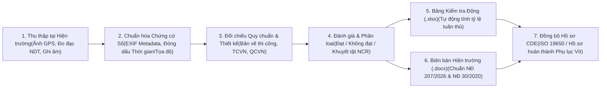

# Nghiên Cứu Hệ Thống Kiểm Tra, Khảo Sát Và Giám Sát Tại Hiện Trường (Field Inspection, Site Survey & Construction Supervision)

Thư mục này lưu trữ hồ sơ nghiên cứu nghiệp vụ kỹ thuật, quy trình pháp lý, kiến trúc thu thập dữ liệu số tại công trường (Offline-First Field Data Acquisition) và bộ công cụ tự động hóa xuất bản **Biên bản khảo sát / Biên bản kiểm tra hiện trường / Biên bản nghiệm thu (.docx)**, **Bảng kiểm tra danh mục hiện trường (.xlsx)** tuân thủ khung pháp luật xây dựng hiện hành.

---

## 1. Cơ Sở Pháp Lý & Quy Chuẩn Kỹ Thuật Áp Dụng

Toàn bộ quy trình nghiệp vụ, biểu mẫu biên bản và danh mục kiểm tra trong thư mục nghiên cứu này được chuẩn hóa theo các văn bản quy phạm pháp luật đang có hiệu lực:
- **Luật Xây dựng số 135/2025/QH15**: Quy định về khảo sát xây dựng, thi công xây dựng, giám sát thi công xây dựng và quản lý chất lượng công trình.
- **Luật Phòng cháy, chữa cháy và cứu nạn, cứu hộ số 55/2024/QH15**: Quy định về yêu cầu an toàn PCCC trong quá trình thi công và nghiệm thu.
- **Nghị định số 207/2026/NĐ-CP**: Quy định chi tiết về quản lý chất lượng, thi công xây dựng và bảo trì công trình xây dựng:
  + **Điều 22**: Nghiệm thu công việc xây dựng.
  + **Điều 23**: Nghiệm thu giai đoạn thi công xây dựng hoặc bộ phận công trình xây dựng.
  + **Điều 24**: Nghiệm thu hoàn thành hạng mục công trình, công trình xây dựng đưa vào sử dụng.
  + **Điều 25 – Điều 27**: Kiểm tra công tác nghiệm thu công trình xây dựng của cơ quan chuyên môn về xây dựng.
  + **Phụ lục VII**: Danh mục hồ sơ hoàn thành công trình xây dựng.
- **Nghị định số 217/2026/NĐ-CP**: Quy định chi tiết một số nội dung về quản lý dự án đầu tư xây dựng (quản lý công tác khảo sát xây dựng, nhiệm vụ khảo sát, phương án kỹ thuật khảo sát).
- **Nghị định số 105/2025/NĐ-CP** và **Nghị định số 347/2026/NĐ-CP**: Quy định về kiểm tra hiện trường, cơ chế Chủ đầu tư tự tổ chức nghiệm thu về PCCC và khai báo trên Hệ thống Cơ sở dữ liệu quốc gia về PCCC.
- **Nghị định số 206/2026/NĐ-CP**: Quản lý chi phí đầu tư xây dựng (xác nhận khối lượng phát sinh, khảo sát bổ sung tại hiện trường).
- **Nghị định số 210/2026/NĐ-CP**: Quy định về hợp đồng xây dựng (quản lý thay đổi, điều chỉnh khối lượng và nghiệm thu theo hợp đồng).
- **Thông tư số 34/2026/TT-BXD**: Quy định về phân cấp công trình xây dựng phục vụ quản lý chất lượng và kiểm tra hiện trường.
- **Nghị định số 30/2020/NĐ-CP**: Quy định về công tác văn thư và thể thức trình bày văn bản hành chính.

---

## 2. Cấu Trúc Thư Mục Nghiên Cứu

```text
Nghien_Cuu_Kiem_Tra_Khao_Sat_Giam_Sat_Hien_Truong/
├── README.md                                                              # Tổng quan kiến trúc, khung pháp lý & luồng nghiệp vụ hiện trường
├── docs/
│   ├── 01_Quy_Trinh_Khao_Sat_Hien_Truong_Va_Thu_Thap_Du_Lieu_So.md         # Quy trình khảo sát địa chất, địa hình, đánh giá hiện trạng & thu thập chứng cứ số
│   ├── 02_Quy_Trinh_Giam_Sat_Thi_Cong_Va_Nghiem_Thu_ND207_2026.md          # Nghiệp vụ giám sát thi công, nhật ký công trình & nghiệm thu theo NĐ 207/2026/NĐ-CP
│   ├── 03_Kiem_Tra_Hien_Truong_Chuyen_Nganh_Ket_Cau_MEP_PCCC.md           # Danh mục kiểm tra kỹ thuật hiện trường: Kết cấu, Kiến trúc, Cơ điện (MEP) & PCCC
│   └── 04_Kien_Truc_Ung_Dung_Di_Dong_Offline_First_Hien_Truong.md         # Kiến trúc ứng dụng hiện trường Offline-First (Ảnh GPS Watermark, Ghi âm, Đồng bộ CDE)
├── prototypes/
│   ├── field_evidence_processor.py                                        # Công cụ trích xuất EXIF GPS, đóng dấu thông tin hiện trường & lập danh mục ảnh chứng cứ
│   ├── export_field_inspection_docx.py                                    # Engine xuất Biên bản khảo sát / Kiểm tra / Nghiệm thu (.docx) chuẩn NĐ 30/2020 & NĐ 207/2026
│   └── export_field_checklist_xlsx.py                                     # Engine xuất Bảng kiểm tra hiện trường (.xlsx) sử dụng công thức Excel động 100%
├── field_data/
│   ├── photos/                                                            # Lưu trữ ảnh chụp hiện trường gốc & ảnh đã đóng dấu tọa độ/thời gian
│   ├── audio_notes/                                                       # Lưu trữ tệp ghi âm thuyết minh khiếm khuyết tại công trường
│   └── measurements/                                                      # Lưu trữ dữ liệu đo đạc trắc địa, thí nghiệm không phá hủy (NDT), thông số môi trường
├── checklists/                                                            # Thư mục lưu trữ các bảng kiểm tra hiện trường (.xlsx)
└── output_reports/                                                        # Thư mục lưu trữ Biên bản kiểm tra, khảo sát, giám sát hoàn chỉnh (.docx)
```

---

## 3. Kiến Trúc Luồng Xử Lý Dữ Liệu Hiện Trường (Field-to-Office Pipeline)



---

## 4. Phân Nhóm Nghiệp Vụ Trọng Tâm Tại Hiện Trường

| Phân nhóm nghiệp vụ | Mục tiêu kỹ thuật tại hiện trường | Dữ liệu đầu vào bắt buộc | Hồ sơ đầu ra theo quy định |
| :--- | :--- | :--- | :--- |
| **1. Khảo sát hiện trường (Site Survey & Existing Condition Assessment)** | Xác định điều kiện địa hình, địa chất công trình, thủy văn, hiện trạng công trình lân cận và hạ tầng kỹ thuật ngầm/nổi trước khi thiết kế hoặc thi công. | Nhiệm vụ & Phương án kỹ thuật khảo sát (Nghị định số 217/2026/NĐ-CP); tọa độ mốc trắc địa; ảnh chụp hiện trạng có gắn tọa độ địa lý; số liệu khoan địa chất / đo đạc thực địa. | Biên bản nghiệm thu kết quả khảo sát xây dựng; Báo cáo kết quả khảo sát xây dựng; Hồ sơ hiện trạng công trình lân cận. |
| **2. Giám sát thi công xây dựng (Construction Supervision)** | Theo dõi thường xuyên, liên tục quá trình thi công trên công trường về chất lượng, khối lượng, tiến độ, an toàn lao động và vệ sinh môi trường theo thiết kế được duyệt. | Bản vẽ thi công đã thẩm định/phê duyệt; Chỉ dẫn kỹ thuật (Technical Specifications); Biên bản lấy mẫu vật liệu đầu vào; Nhật ký thi công xây dựng. | Biên bản nghiệm thu công việc xây dựng (Điều 22 NĐ 207/2026/NĐ-CP); Biên bản nghiệm thu giai đoạn (Điều 23); Thông báo yêu cầu khắc phục sai sót (NCR). |
| **3. Kiểm tra hiện trường & Kiểm định chất lượng (Field Inspection & Testing)** | Đo đạc kiểm chứng độc lập thông số hình học, cường độ vật liệu (bê tông, thép, liên kết bu lông), thử áp lực đường ống, thông gió, chống sét, liên động PCCC. | Thiết bị đo được kiểm định/hiệu chuẩn hợp lệ (súng bật nẩy, siêu âm bê tông, máy toàn đạc, đồng hồ đo áp, thiết bị đo điện trở cách điện/tiếp địa). | Biên bản kiểm tra hiện trường; Phiếu kết quả thí nghiệm hiện trường; Danh mục kiểm tra (Checklist) theo từng chuyên ngành. |
| **4. Kiểm tra công tác nghiệm thu (State & Investor Inspection)** | Phục vụ Chủ đầu tư và Cơ quan chuyên môn về xây dựng kiểm tra hiện trường và hồ sơ hoàn thành công trình trước khi đưa vào khai thác, sử dụng. | Danh mục hồ sơ hoàn thành công trình theo Phụ lục VII Nghị định số 207/2026/NĐ-CP; Bản vẽ hoàn công; Hồ sơ tự nghiệm thu PCCC theo Nghị định số 347/2026/NĐ-CP. | Biên bản kiểm tra công tác nghiệm thu (Điều 25-27 NĐ 207/2026/NĐ-CP); Văn bản chấp thuận kết quả nghiệm thu của cơ quan chuyên môn. |

---

## 5. Hướng Dẫn Chạy Các Công Cụ Mẫu (Prototypes)

1. **Tạo Bảng kiểm tra (Checklist) hiện trường Excel động (`.xlsx`)**:
   ```powershell
   python prototypes/export_field_checklist_xlsx.py
   ```
2. **Tạo Biên bản kiểm tra, khảo sát và nghiệm thu hiện trường (`.docx`) chuẩn Nghị định số 30/2020/NĐ-CP**:
   ```powershell
   python prototypes/export_field_inspection_docx.py
   ```
3. **Xử lý siêu dữ liệu ảnh chụp chứng cứ hiện trường**:
   ```powershell
   python prototypes/field_evidence_processor.py --help
   ```
