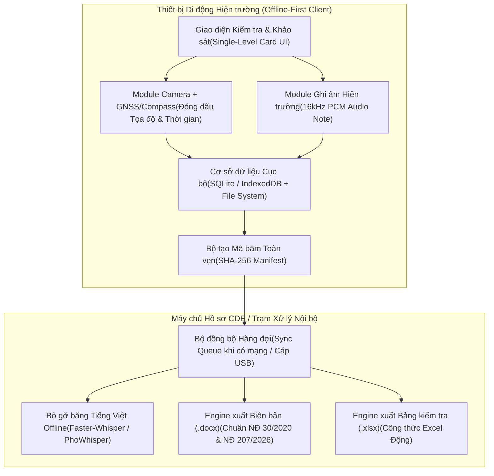

# Kiến Trúc Ứng Dụng Di Động Hiện Trường Độc Lập Không Cần Mạng (Offline-First Field Mobile Architecture)

Tài liệu này mô tả kiến trúc kỹ thuật của ứng dụng hỗ trợ kỹ sư kiểm tra, khảo sát và giám sát tại hiện trường hoạt động trong điều kiện mất kết nối mạng (tầng hầm sâu, khu vực công trường chưa có sóng viễn thông, phòng kỹ thuật bọc kim loại).

---

## 1. Yêu Cầu Kỹ Thuật Đặc Thù Tại Công Trường Xây Dựng

1. **Hoạt động 100% không cần kết nối mạng (100% Offline Availability)**:
   - Toàn bộ giao diện, danh mục kiểm tra (Checklist), bản vẽ mặt bằng định vị (Floor Plans), bộ tiêu chuẩn tra cứu nhanh (TCVN/QCVN) và bộ máy lưu trữ phải nằm cục bộ trên thiết bị di động.
2. **Chống làm giả chứng cứ hiện trường (Tamper-Evident Field Evidence)**:
   - Ảnh chụp tại hiện trường tự động đọc tọa độ phần cứng GNSS/GPS, góc hướng nhìn la bàn từ cảm biến từ trường (`Magnetometer`) và đồng hồ hệ thống để vẽ trực tiếp khung thông tin (Watermark) lên điểm ảnh kèm mã băm `SHA-256`.
3. **Thao tác một tay trong môi trường bảo hộ lao động**:
   - Kỹ sư đội mũ bảo hộ, đeo găng tay tại công trường có thể nhấn 1 nút để chụp ảnh + thu âm giọng nói mô tả lỗi kỹ thuật (Voice-to-Defect) thay vì phải gõ bàn phím nhỏ trên màn hình.

---

## 2. Sơ Đồ Kiến Trúc Lưu Trữ Cục Bộ & Đồng Bộ CDE (ISO 19650)



---

## 3. Cấu Trúc Bản Ghi Kiểm Tra Hiện Trường (Field Inspection Record Schema)

Mỗi điểm kiểm tra hoặc khuyết tật ghi nhận tại hiện trường được lưu dưới dạng cấu trúc JSON chuẩn hóa để dễ dàng kết xuất sang Biên bản Word (`.docx`) và Bảng tính Excel (`.xlsx`):

```json
{
  "record_id": "INSP-20261016-001",
  "project_code": "DA01-IBST",
  "project_name": "Tòa nhà Trung tâm Nghiên cứu và Phát triển Công nghệ",
  "inspection_type": "NGHIEM_THU_CONG_VIEC",
  "legal_basis": "Điều 22 Nghị định số 207/2026/NĐ-CP",
  "timestamp_iso": "2026-10-16T09:30:15+07:00",
  "location": {
    "zone": "Tầng hầm B1",
    "grid_axis": "Trục (B-C)/(3-4)",
    "elevation_m": -4.50,
    "gps_lat": 21.004512,
    "gps_lon": 105.798234,
    "compass_azimuth_deg": 135.0
  },
  "discipline": "KET_CAU",
  "check_item": "Lắp dựng cốt thép dầm sàn tầng hầm B1 trước khi đổ bê tông",
  "standard_ref": "TCVN 4453:1995 - Bảng 6 & Bản vẽ KC-B1-05",
  "design_value": "Chiều dày lớp bê tông bảo vệ cốt thép chịu lực dầm a = 25 mm (±5 mm)",
  "measured_value": "Đo thực tế tại 10 vị trí đạt từ 24 mm đến 27 mm; con kê bê tông đặt khoảng cách 1.0 m/viên",
  "evaluation": "ĐẠT",
  "evidence_files": [
    "field_data/photos/DA01-IBST-B1-IMG-STR-0001_20261016_093015.jpg"
  ],
  "sha256_checksum": "e3b0c44298fc1c149afbf4c8996fb92427ae41e4649b934ca495991b7852b855"
}
```
